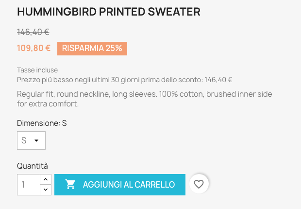
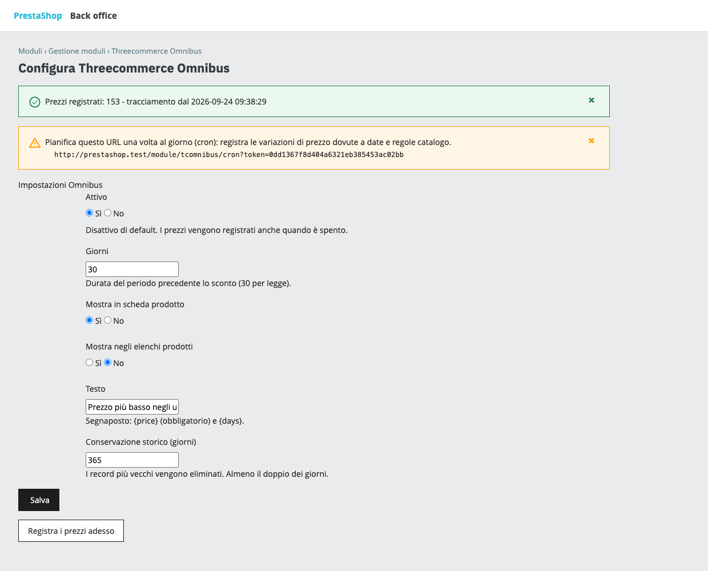

# Threecommerce Omnibus: lowest price of the last 30 days for PrestaShop

A PrestaShop module for the **EU Omnibus Directive** (2019/2161, in Italy D.Lgs. 26/2023, art. 17-bis of the Consumer Code). It records the price history of your products and, when a product is on sale, shows the **lowest price applied in the 30 days before the discount**.

**Compatibility:** PrestaShop 8.0+ / 9.x declared (tested on 9.2.0) · PHP 8.1 – 8.4 · Hummingbird theme tested
**License:** commercial · coming soon

## Features

- **Price history** per product and combination, shop, customer group and currency. A row is written only when the price changes: product and combination save, specific prices added, edited or deleted. The history is recorded even while the notice is switched off, so it is complete when you turn it on.
- **Reference price**: the lowest price in force during the previous *N* days (30 by default) before the **first reduction** of the current series of discounts. With progressive discounts (100 → 80 → 70) the reference stays the price before the first reduction.
- **Notice under the price** on the product page, and optionally in product lists: *"Lowest price in the last 30 days before the discount: …"*. The text is editable per language, with `{price}` and `{days}` placeholders.
- **Nothing is made up**: the notice appears only if the product is discounted, the current price is lower than the reference and the history covers the whole period. Without enough history it stays hidden.
- Price shown according to the customer group's tax display and the visitor's currency.
- **Daily cron** (a secured URL shown in the module page) records the changes that do not go through a save — price date ranges and catalog price rules — and prunes old rows. A button records prices on demand.
- Italian translation included. The notice uses the theme's own classes, no extra CSS.

## Requirements

- PrestaShop 8.0 or newer, or 9.x
- PHP 8.1 or newer
- A theme that calls the product price block hook (`displayProductPriceBlock`), as Classic and Hummingbird do
- A daily call to the cron URL for date ranges and catalog price rules

## Tested with

PrestaShop 9.2.0 with the Hummingbird theme: installation, price history, specific prices, the notice on the product page and the cron URL. PrestaShop 8 and the Classic theme have **not** been tested yet.

## Limits

- The history starts at installation: a product that is already discounted when the module is installed shows no notice until a later reduction, with enough history before it.
- Prices specific to a single customer, cart or minimum quantity are not tracked: the history is per group and currency, quantity 1. Country-specific prices use the shop's default country.
- The module does not change the theme's struck-through price; it adds the notice next to it.
- It is not legal advice: check the rules for your promotions with your own advisor.

## Availability

This module is **not yet available for purchase**. See the [product page](https://www.threecommerce.it/omnibus-prestashop?utm_source=github&utm_medium=readme&utm_campaign=prestashop-omnibus) for its status, or [get in touch](https://www.threecommerce.it/contatti?utm_source=github&utm_medium=readme&utm_campaign=prestashop-omnibus) to be notified at launch or to ask for information.

## Documentation and support

- Product page: [threecommerce.it/omnibus-prestashop](https://www.threecommerce.it/omnibus-prestashop?utm_source=github&utm_medium=readme&utm_campaign=prestashop-omnibus)
- [Changelog](CHANGELOG.md) (in Italian)
- Support and custom development: [threecommerce.it/contatti](https://www.threecommerce.it/contatti?utm_source=github&utm_medium=readme&utm_campaign=prestashop-omnibus)

---

*This repository is the public showcase of the module. The source code is kept in a private repository.*
